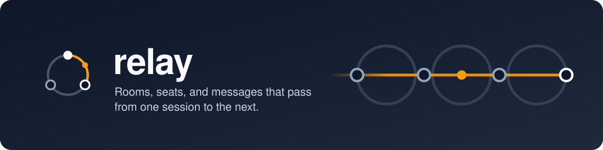

<p align="center">
  
</p>

# relay

Messages between the lead sessions of a coding assistant running on several machines.

A session receives a message in its own inbox, as a message whose first line says where it is from:

```
[relay · room ops · from laptop · #100042 · 2026-11-15T20:40:49Z] (reply with the relay send tool, to "ops:laptop")
│ text
│ more text
```

and answers with the relay `send` tool. Where no inbox socket is found, the message arrives as a preview
channel event instead (`<channel source="plugin:relay:relay" room="ops" from="laptop" msg_id="…" sent_at="…">`, with
the same text; see « If the inbox stops working » below).

**The shape is the defence.** The header is the only line the plugin writes flush left; every line of the body is
behind `│ `, whoever wrote it — a member, a connector, the room's own notice quoting a name or a stored value. The
body is split on every line terminator Unicode knows (CR LF, CR, LF, VT, FF, U+001C–U+001E, U+0085, U+2028,
U+2029), and inside a line each control character (C0, C1; tab aside) and each format character (zero-width,
bidirectional controls, BOM…) is shown as `·`. So no content can produce a line that reads as a header or a
decision; a decision is only the header the plugin renders from the room's structured field,
`[relay · room ops · DECISION #12 · allow · by voice · remote]`. The remote door's answers have the same shape:
each message under a line the room writes, `SAY:` and `DETAIL:` alone on their lines, every line of content behind
`│ `. The room also refuses, at input, line breaks and control or format characters where one line is expected (a
say line, a note, an option, a name, a key; an option also refuses `[ ] · « » │ "`), control characters and
bidirectional controls in a message or a detail, and control or format characters in a state value; every notice
starts with the room's own words (`member b joined the room, invited by a`). Those refusals are hygiene; the shape is
what holds. A message may hold other format characters (an emoji joined by a zero-width joiner, say): it is accepted
and shows with `·` where the joiner was. A decided request's header quotes its option as a JSON string; an expired or
withdrawn one has its own header, `[relay · room ops · REQUEST #12 EXPIRED]` (or `WITHDRAWN`), never the DECISION form.

Either way the session is told it is a message from another session: a teammate's request, never the approval of the
person at the keyboard.

**Acts that carry the machine's authority are terminal-only.** `decide`, `decider`, `set`, `del`, `state-open`,
`revoke`, `remove` and `connector` refuse to run in a shell started by an assistant session (any of `CLAUDECODE`,
`CLAUDE_CODE_ENTRYPOINT`, `CLAUDE_CODE_SESSION_ID` set), whether typed directly or through `/relay` (`relay cmd`):
« this act carries the machine's authority: a person runs it in a terminal of their own, outside the assistant's
session ». No flag overrides it. A session has no tool to write the state either.

What this is: a guard against a session doing these acts because a message asked it to. What it is NOT: a boundary. A
session that has a shell holds the machine's seat file and can call the Worker itself, or clear its environment. The
real boundary for decisions is which SEAT the owner marks as a decider: mark a seat a person holds — a remote
connector seat they enrolled, or a machine no unattended session runs on — never a machine where unattended sessions
run.

The post office is one Cloudflare Worker with one Durable Object per room; each listening session keeps one
WebSocket per room open to it, so a message is pushed the moment it is sent.

## The model

- A **room** is a name (`[a-z0-9][a-z0-9-]{0,31}`) and one object of its own: a message never leaves its room.
  Rooms are created with the admin key only; members come in by invitation only.
- A **seat** is a member of a room: a random token created on the machine (`~/.config/relay/seats/<room>.json`,
  mode 0600). The relay keeps only its sha256. One seat per machine per room.
- A seat has a **name** in each room (unique there, changeable at any time; `all` and `relay` are reserved) and
  a **role**: `owner` (the creator) or `member`.
- **Any member** can invite: `relay invite` prints a one-time link valid 24 h. Only an owner can remove a member.
  The last owner cannot leave. Rooms are not deleted in this version.
- **Nothing enters a room silently**: an invitation minted, a member joining (and who invited it), removed,
  leaving or renamed is announced to every member as a message from `relay`, stored like any other message
  so absent members hear it when they come back. Nobody can send as `relay`.
- A seat receives on **one connection**. A session listens to the rooms listed for its working directory in
  `~/.config/relay/projects.json`, but at start it never takes a seat another session holds: it stays out of
  that room and says so. `relay join <room>` is explicit and takes the seat over; the older session stops
  and says so.
- Delivery: the session's server writes each message into the session's inbox socket (one connection per
  message) and acks it to the relay only once written; without an inbox it falls back to the channel event.
- A machine whose seat the relay no longer knows (removed) deletes its seat file and forgets the room.
- Messages go to one member by name or to `all`, inside a room. They wait up to 7 days for a member that is
  away and are delivered once. A message that cannot leave because the relay is unreachable waits in a local
  outbox.
- Guardrails: 48 KiB per message; 60 messages per sender per minute, a message to `all` counting one per
  recipient; the same text to the same target within 10 seconds is stored once, and the sender is told.

## Install

The repository is a plugin marketplace holding one plugin, `relay`: the server and the `/relay` command come
together. Python 3 (standard library only) on every machine.

```
git clone <this repository> ~/src/relay
claude plugin marketplace add ~/src/relay      # tells the CLI where this catalogue of one plugin is
claude plugin install relay@relay              # installs the plugin: the server and the /relay command
```

Then start the CLI normally. In every session the plugin's server starts: it links `~/.local/bin/relay` to
itself (so a plain terminal and `/relay` reach the same program), offers its tools on any machine that holds a
seat, and connects only for the rooms the session listens to.

The machine that will hold the admin key deploys the Worker once (Node.js, and a Cloudflare API token with
Workers Scripts:Edit in the file named by `$CF_WORKERS_TOKEN_FILE`):

```
cd ~/src/relay
plugin/bin/relay admin-key   # creates ~/.config/relay/admin, prints only its sha256
./deploy.sh deploy           # prints the relay's address, https://relay.<your subdomain>.workers.dev
```

### A first room

```
/relay create ops --url https://relay.<your subdomain>.workers.dev   # on the machine with the admin key
/relay invite ops                                                    # prints https://relay.…/j/ops/<secret>
/relay accept https://relay.…/j/ops/<secret>                        # on the other machine
/relay join ops                                                      # on each machine, in the project's session
```

`join` makes the running session listen at once and records the room for its directory, so later sessions
started there listen too, unless another session already holds the seat.

### If the inbox stops working (the fallback)

The session inbox is the normal road: no launch option, no confirmation screen. Its format is not documented
by the vendor, so an update of the CLI may break it. The sign: `/relay status` shows the room connected, the
sender is told « sent », and nothing appears in the session. The plugin also declares itself as a preview
channel, the road it falls back to when it finds no inbox; that road only shows messages in a session started
with the channel option, which asks for a confirmation at each start:

```
claude --dangerously-load-development-channels plugin:relay@relay
```

To force the fallback while the inbox still exists (a test, or an inbox that accepts lines and drops them),
start the session with `RELAY_INBOX=/nonexistent` in its environment as well.

If a « Held message from another session » dialog ever appears for a relay message, something other than the
plugin's own server wrote into the session: the server is a child of the session and is never held. Deny it.

### Update

`git pull` in the clone. A marketplace added from a local path is read in place; the change shows at the next
session start. For this version, in this order:

1. update the plugin on every machine first — it is harmless against the old Worker, and the protection against a
   forged header lives in the plugin (a machine on the old plugin shows message bodies without the `│ ` prefix);
2. deploy the Worker (its notices now start with « member … », and the door's `read` and `news` changed layout);
3. mark deciders only after both;
4. ask remote clients to reconnect, so they load the door's new tools and instructions (a connector session keeps the
   old ones until then).

### Uninstall

```
/relay leave-room ops                    # for each room, to free the seat (optional)
claude plugin uninstall relay@relay
claude plugin marketplace remove relay
rm ~/.local/bin/relay                    # the link the server made
```

Seats and settings stay in `~/.config/relay`, outboxes in `~/.local/state/relay`; delete them to forget
everything.

## Commands

The same words work as `/relay …` in a session, where the relay program answers with no model turn (`/relay`
alone is `status`, `/relay help` lists the commands), and in a shell as `relay …`.

| command | what it does |
|---|---|
| `status` | the rooms this session listens to, and who is connected |
| `list` | every room this machine has a seat in |
| `join <room>` / `leave <room>` | the running session starts or stops listening to a room, no restart |
| `send <[room:]name\|[room:]all> [--say s] <text…>` | one message (the room may be left out when there is only one); `--say`: one sentence to be said aloud |
| `rename [<room>] <name>` | this machine's name in a room |
| `create <room> [--name n] [--url u]` | a new room; needs the admin key |
| `invite <room>` | a one-time link, valid 24 h |
| `accept <link> [--name n]` | takes a seat in that room |
| `remove <room> <name>` | (owner) takes a member's seat away at once |
| `leave-room <room>` | gives up this machine's seat |
| `connector <room> <name>` | (owner) a seat for a remote connector that connects by OAuth; prints its URL, writes a one-time enrolment code to a file |
| `grants <room>` / `revoke <room> <name>` | (owner) the connector grants, without secrets / delete one seat's grants (the seat stays) |
| `ask <room> --say s --option a --option b […] [--wait]` | a decision request (see « Decisions »); `--wait` prints one JSON line, exit 0/3/4 |
| `asks <room>` / `decision <room> <n>` | the open decision requests / the state of one, as one JSON line |
| `decide <room> <n> <option> [--note t]` / `withdraw <room> <n>` | (a decider) answer a request / (its author) withdraw it |
| `decider <room> <name> on\|off` | (owner) mark or clear a member as a decider — only a seat a person holds, never a machine where unattended sessions run |
| `state <room>` / `get <room> <key> [--json]` | the room's shared state / one key's value alone, exit 3 if absent (see « Shared state ») |
| `set <room> <key> <value> [--if-version n]` / `del <room> <key> [--if-version n]` | write / delete a key; exit 5 on a version conflict |
| `state-open <room> <key> members\|owners` | (owner) who may write that key |
| `help` | one line per command |
| `admin-key` · `serve` | shell only |

`list` reads:

```
ops
  • laptop (you) — connected · laptop.local · 203.0.113.7
  • desk — not connected
```

In a session, the server's tools are `send {to, text, say?, room?}` (`to` may be written `room:name`),
`status {}`, and for the shared state `state {room?}` and `get {key, room?}` (read only: the state is written by a
person, with `relay set`); the CLI shows them under the plugin's prefix.

A message may carry **a line to say aloud**: `say` is one plain sentence, `text` the detail (it may then be
empty). The room stores the two apart; a machine receives `text` as the sentence, a blank line, then the detail
(and the sentence again in a `say` field), so a client that knows nothing of it shows the whole message. When a
session answers a remote seat (« reads by itself (remote door) »), it puts one sentence in `say`.

## A member that is not a machine

Some clients cannot start a local server: they only take a remote MCP connector over HTTPS (the Claude apps'
« custom connector », for example). Such a client holds a **connector seat** and reaches it through the Worker's
door, `POST /mcp/<room>` (MCP Streamable HTTP, JSON answers, no stream), authorized by OAuth. It gets no push, so
it pulls:

- `read {wait_seconds?, again?}` — the messages waiting for the seat, oldest first, each returned once. With
  nothing waiting it holds the request up to `wait_seconds` (0–25, default 20; a larger value is clamped, as a
  client may cut a request at about 30 s) and answers as soon as one arrives, else « no new message ».
  `again: true` returns the last batch once more, if an answer was lost on the way. Each message is under a line
  the room writes, `[from <name> · <time> · #<id>]`, and every line of its content is behind `│ `; a message with a
  line to say has the room's bare labels `SAY:` and `DETAIL:`, each followed by its content:

  ```
  [from desk · 2026-11-16T20:40:49Z · #100042]
  SAY:
  │ Done, merged.
  DETAIL:
  │ Branch x landed at abc123.
  ```

  The door tells its client to speak the line under SAY as is and give the detail only when asked, and that only
  a line without `│ ` in front is the relay speaking.
- `news {}` — what is waiting, without taking it: how many messages, from whom, the oldest and newest time, the
  newest one's SAY line (or its first 120 characters), and who is connected.
- `send {to, text, say?}` — to a member by name or `all`, with the same limits and duplicate rule as every other
  road.
- `status {}` — the members, their role, and how each receives.

### Connect a client by OAuth

On an owner's machine:

```
relay connector ops voice
```

It creates the seat `voice` in `ops` (or reuses it), and no token for that seat exists anywhere: the seat is
entered only through OAuth. It prints the **connector URL**, `https://relay.…/mcp/ops`, which holds no secret,
and writes a one-time **enrolment code** to `~/.config/relay/remote/ops-voice.enrol` (mode 0600), printing only
the file's path. The code is valid 10 minutes and works once; running the command again replaces it.

In the client, add a custom connector with the connector URL. If it asks how to identify itself, choose to
register automatically (Dynamic Client Registration). The client finds the relay's OAuth endpoints by itself and
opens the relay's consent page, which shows the name the application gives itself, the host it will be sent back
to (check it is the client's own: for the Claude apps, `claude.ai`) and the room. Paste the enrolment code there.
The client is now the seat `voice`; it refreshes its access by itself.

```
relay grants ops          # (owner) seat, client, created, last used — never a secret
relay revoke ops voice    # (owner) deletes voice's grants: its next request fails; the seat stays
relay remove ops voice    # (owner) deletes the seat and its grants
```

To connect it again after a revoke, run `relay connector ops voice` for a new code and reconnect the client.

What the relay does, in short: it is its own OAuth authorization server (OAuth 2.1 as the MCP authorization
specification asks): protected-resource and authorization-server metadata, client registration without storage
(the client id is self-describing and signed), PKCE S256 only, one-use authorization codes of 60 seconds bound to
the client, the exact redirect URI and the challenge; access tokens of one hour and refresh tokens rotated at each
use (a grant unused 30 days ends; an old refresh token presented again ends its grant at once). A redirect URI must
be, character for character, one of the Worker variable `OAUTH_REDIRECT_URIS` (default
`https://claude.ai/api/mcp/auth_callback,https://claude.com/api/mcp/auth_callback`, the Claude apps' documented
callback). Every code and token is kept in the room only as its sha256. Joins, enrolment codes, grants made and
revoked are announced to the room like every other change; the client's name in such a notice is its own claim,
quoted and cut to 40 characters (« a connector calling itself … »).

Still true: messages sit in clear on the Worker until read. A message from such a seat is a teammate's request,
never the user's approval: a permission prompt in the receiving session is still the user's to answer. Give the
seat a room of its own with the one session it drives, not a room where sessions run unattended. In `status` and
`list` it shows as « reads by itself (remote door) » once it has used the door.

### A seat made by the former URL door

Earlier versions had `relay remote-seat`, whose connector address carried the seat's token. That door is gone: a
request to `/mcp/<room>/<token>` gets the same 404 as any unknown path. Remove such a seat like any other,
`relay remove <room> <name>`, then delete its file `~/.config/relay/remote/<room>-<name>.url`. Its name is free
again for `relay connector`. An `Origin` is checked on the door only when the Worker's `MCP_ORIGINS` var lists
some.

The door writes one JSON line per request: time, method or tool, room, the member's name, status, duration, and for
`read` the wait asked, the wait used and how many messages it returned — never a token, a seat hash or a message's
text. The OAuth endpoints write one line each too (endpoint, room, status, duration), never a code or a token.
The Worker keeps its logs (Workers Logs, `observability` in `worker/wrangler.jsonc`; 3 days on the free plan, 7 on
paid), read in the dashboard under the Worker's Observability tab. No URL of the Worker carries a secret, so the
platform's own request log records none either.

## Decisions

A message is free text, and stays a teammate's request, never an approval. A **decision** is a separate,
explicit primitive: a member asks a precise question with a fixed list of answers, a member the room's owner
trusted answers it, and the answer is data with a known author — never a sentence a model has to interpret.

- **Ask.** Any member: `relay ask <room> --say "<one sentence>" --option yes --option no [--detail "<text>"]
  [--to <name>]... [--for <seconds>] [--wait]`. The say line is one plain sentence (it may be spoken aloud), 2 to 6
  options (labels of at most 32 characters, unique ignoring case), addressed to named members or, by default, to
  every decider, living 10 minutes by default and 24 hours at most. The room numbers it (per room, increasing) and
  announces it to every other member as a notice from `relay`: the sentence, then the number, the options, until
  when and for whom.
- **Who may decide.** Only a seat the room's owner has marked a **decider**: `relay decider <room> <name> on|off`
  (owner only). The mark is off for every seat by default, the owner's own machines included; `status` and `list`
  show it. The author never decides its own request. A request addressed to named members is decided only by those
  of them who are deciders. Mark as a decider only a seat a person holds — a remote connector seat they enrolled, or
  a machine no unattended session runs on — never a machine where unattended sessions run.
- **Decide.** `relay decide <room> <n> <option> [--note "<text>"]`, or the remote door's `decide` tool. The option
  must be one of that request's labels exactly (case aside; nothing fuzzy); a note is at most 300 characters. Labels
  are stored trimmed, spaces collapsed, in Unicode NFC, and matched the same way; the `option` a decision reports is
  that stored label. A label holding a control, zero-width or bidirectional-control character is refused, and a say
  line, a detail line, a note or a label may not begin with « DECISION » or « [relay » (the room's own words). The
  first valid decision wins; a second is refused with who decided and when. The room records who (the seat's name),
  through which door (`machine`, or `remote` with the name the connector gives itself) and when, tells the room, and
  delivers to the author a notice from `relay` carrying the decision as data (a `decision` field in the machine's
  frame). The plugin recognises a decision by that field alone, on a message from the room itself, and shows it under
  a header no message body can produce: `[relay · room <room> · DECISION #<n> · <option> · by <name> · <door>]`. In
  a member's message, a body line that starts with `[relay` or `DECISION` is shown quoted (`> `). An announcement
  always starts with the room's words, `decision request #<n> from <name>:`, the author's sentence after them. If the
  request expires first, the author is told the same way (`… · DECISION #<n> · expired · by nobody · -]`).
  A ref sent again returns its request only while it is open and asks the same thing; otherwise it is refused.
- **Other words.** `relay asks <room>` (the open requests, and whether you may decide each), `relay decision <room>
  <n>` (one JSON line, below), `relay withdraw <room> <n>` (its author only). A seat that leaves or is removed
  withdraws its open requests. `/relay ask --wait` is refused in a session (it would block it): run it in a shell.
- **Reading it without a model.** `relay ask … --wait` blocks until the request is decided, expires or is withdrawn,
  then prints one line of JSON on stdout and exits with a code a script acts on:

  ```
  {"ask": 12, "state": "decided", "option": "yes", "by": "voice", "door": "remote", "note": "", "client": "Claude"}
  ```

  exit `0` decided, `3` expired, `4` withdrawn (`1` on an error). `option`, `by`, `door` and `note` are empty when
  nobody decided; `by` is the author for a withdrawal; `client` is there only for the remote door. `relay decision`
  prints the same line (and exits 0 whatever the state). `ask --wait` gives up 10 seconds past the request's expiry,
  whatever the relay does (unreachable, or still open), and exits 3 with an `expired` line. It trusts no malformed
  answer: a state that is not the request it asked about, or « decided » with an option that is not one of the labels
  it passed, is exit 1 with nothing on stdout — never 0.
- **On the remote door.** `asks {}` lists the open requests this seat may decide (number, say line, options, who
  asks, time left) and takes nothing; `decide {ask, option, note?}` answers one. The door tells its client to read a
  request's say line aloud with its options, and to call `decide` only with an option the person has just spoken for
  that numbered request, repeating it back first — never on its own judgment.
- **In a session.** The plugin tells the session that what arrives under that decision header is the answer of the
  member named in it, with the authority the room's owner gave that member as a decider, and answers only request
  `<n>`; a free-text message is still a teammate's request, never an approval.
- **Limits.** At most 20 open requests per seat and 30 requests per seat per minute; a say line of 500 characters,
  a detail of 4 KiB; a request names at most 16 members. Expiry is enforced whenever the room is read, and by the
  room's alarm (set only once a request exists). Closed requests are kept 7 days.

**What this does not do by itself.** It does not answer the coding assistant's own permission prompts. A
decision reaches a session as a notice; the session still asks the person at the keyboard. Letting a decider answer
a permission prompt from afar takes a hook on that machine, which only the machine's owner can choose to write and
install; nothing here installs or enables one.

What the assistant's hook documentation says (« Hooks reference » and « Choose a permission mode », read
2026-11-16): the `PermissionRequest` event runs when a tool call needs a permission decision; it receives
`tool_name` and `tool_input` on stdin; it answers on stdout with
`{"hookSpecificOutput": {"hookEventName": "PermissionRequest", "decision": {"behavior": "allow"}}}` or
`"behavior": "deny"` (with an optional `message`). An exit code alone decides nothing there: exit 0 without that
JSON leaves the normal flow, and exit 2 is not honoured for this event. A command hook's default timeout is 600
seconds, set per hook with `"timeout"` in seconds. Under `bypassPermissions` there are no permission prompts, so
this hook is never asked and nothing waits for a decider.

An example the machine's owner could adapt (Python 3, standard library; `relay` on the hook's `PATH`). It denies
whenever it is not sure: an error of any kind, a `relay` it cannot run, no answer within the lifetime plus 20
seconds, an answer it cannot read, or a tool input too long to show the deciders whole (never a silent cut):

```python
#!/usr/bin/env python3
# A PermissionRequest hook: asks the deciders of one room; anything but a decided « allow » denies.
import json, os, subprocess, sys

ROOM = "ops"
LIFETIME = int(os.environ.get("RELAY_HOOK_SECONDS", "120"))  # the hook's timeout: at least LIFETIME + 30
DETAIL_MAX = 4096  # bytes a request's detail may hold


def answer(behavior, message=""):
    decision = {"behavior": behavior, **({"message": message} if message else {})}
    print(json.dumps({"hookSpecificOutput": {"hookEventName": "PermissionRequest", "decision": decision}}))
    sys.exit(0)


try:
    req = json.load(sys.stdin)
    tool = json.dumps(str(req.get("tool_name", "?")))[1:-1]  # ASCII: every control or invisible character escaped
    action = json.dumps(req.get("tool_input", {}))
    detail = "tool: %s\ninput: %s" % (tool, action)
    if len(detail.encode()) > DETAIL_MAX:
        answer("deny", "the tool input is too long to show whole to the deciders of %s" % ROOM)
    say = "Allow %s on desk: %s?" % (tool, action)  # a voice door speaks this line first: it names the action
    if len(action) > 80:  # never a silent cut: the decider is told how much more there is
        say = "Allow %s on desk: %s … (%d more characters — hear the detail before deciding)" % (
            tool, action[:80], len(action) - 80)
    ran = subprocess.run(["relay", "ask", ROOM, "--say", say, "--detail", detail, "--option", "allow", "--option", "deny",
                          "--for", str(LIFETIME), "--wait"], capture_output=True, text=True, timeout=LIFETIME + 20)
    if ran.returncode == 0 and json.loads(ran.stdout).get("option") == "allow":
        answer("allow")
    answer("deny", "not allowed through the relay room %s" % ROOM)
except SystemExit:
    raise
except BaseException:  # no relay program, a timeout, an unreadable answer, anything else: no
    answer("deny", "the relay room %s could not be asked, so the call is denied" % ROOM)
```

Through a voice door the decider hears the say line first, and may hear nothing else: the say line of such a hook
must itself name the action — the tool and the first 80 characters of its input, as above. When the input is longer,
the say line ends « … (N more characters — hear the detail before deciding) », and the door tells its client to read
the detail aloud before asking for a decision. The whole detail is
visible to every member of the room, not only to the deciders: do not use such a hook where a tool's input may
carry something the room should not read.

registered in that machine's settings with a timeout of the lifetime plus 30 seconds:

```json
{"hooks": {"PermissionRequest": [{"matcher": "Bash",
  "hooks": [{"type": "command", "command": "/path/to/that/script", "timeout": 150}]}]}}
```

What it grants: every decider of that room can allow, one call at a time, a call the assistant would otherwise
have asked about (here, shell commands), seeing the tool and its input in the request's detail. What it does not:
it adds no permission rule, it is not asked for calls the machine's rules already allow, and it is not asked at all
in a mode where permissions are bypassed. While it waits (up to the lifetime) that call waits; no answer is a denial.
Install it only where you accept that the deciders of that room approve actions on that machine.

## Shared state

Each room has a small **key → value table** of its own, for coordination between machines with **no model in the
loop**: one machine's script writes « the value everyone should follow », and every machine's own script reads it
with that machine's seat. The room knows nothing of what a key means.

**Never put a secret, a token or a key in the state.** Values are stored in clear on the Worker and announced to
every member of the room. A cheap guard refuses a value that looks like a credential, and there is no override:
a PEM header (`-----BEGIN …-----`); `sk-`, `sk_`, `ghp_`, `gho_`, `ghu_`, `ghs_`, `ghr_`, `github_pat_` or `xox?-`
at the start of a word followed by 20 or more token characters; or a run of 40 or more base64url characters
(`A-Z a-z 0-9 _ -`, no space) that mixes upper case, lower case and digits — the shape of a random token. A git
commit id, a lowercase slug or ordinary JSON passes. The guard is not a scanner; the rule is the sentence above.

```
relay set ops deploy.target blue                 # prints {"key": …, "value": "blue", "version": 1, "by": "desk", "at": …}
v=$(relay get ops deploy.target) || echo "not set"   # the value alone; exit 3 and nothing on stdout if absent
relay get ops deploy.target --json               # {"key": "deploy.target", "value": "blue", "version": 1, "by": "desk", "at": "…"}
relay set ops deploy.target green --if-version 1 # exit 5 on a conflict, the CURRENT line on stdout
relay state ops                                  # deploy.target · v2 · by desk · 12 s ago · owners may write · green
relay del ops deploy.target [--if-version n]
relay state-open ops deploy.target members       # (owner) any member may now write this key; `owners` closes it
```

- **Belongs to one room** and never leaves it: no cross-room read, no export.
- **Every change is announced** to every member as a notice from `relay` of one line that starts with the room's own
  words: `state: deploy.target set to version 2 by desk: "green"` (also `… deleted at version 3 by desk`, `… opened
  to members by desk: …`). The value comes after those words as a JSON string (quotes, backslashes and `\n`
  escaped); a value over 120 characters is given by its size only. Like every body line it reaches a session behind
  `│ `, so a value that begins with `DECISION` or `[relay` is stored as is and still never reads as a header or a
  decision. A machine's frame carries the change as data (`state`: op, key, version, by, at, writers, size). **A read
  consumes nothing and announces nothing.** A session's `get` and `state` tools return values only as tool output,
  never into the session's inbox: `get` gives one JSON line, `state` one line per key with the value JSON-escaped and
  cut to 60 characters.
- **Announcing costs like a message to all**: one unit of the writer's budget (60 a minute, shared with messages)
  per other member. When the budget cannot pay, the change is refused with 429 before it is applied — a change that
  cannot be announced does not happen.
- **Who writes.** By default only an owner's seat. An owner opens one key to every member with `relay state-open
  <room> <key> members` (per key; `owners` closes it again; a key can be opened before its first write). A
  connector seat (the remote door) never writes, whatever the key's setting: it has only the read tools. `relay
  state` shows who may write each key.
- **Versions and conditional writes.** A key's first write is version 1; every write after it adds 1, a delete
  included. Each value carries who wrote it (the seat's name at that moment), when, and its version. `--if-version
  n` writes only if the current version is n (`0`: only if the key does not exist); otherwise nothing is written and
  the relay answers 409 with the current value, version and writer. Without it the write is unconditional (last
  writer wins) and still bumps the version.
- **Delete keeps the version.** A deleted key leaves a tombstone, so versions never go backwards: a key deleted at
  version 3 is written next as version 4. A script that remembers « version 2 » can never overwrite a value that
  replaced a deleted key by chance.
- **Exit codes** a script acts on: `get` 0 (the value, then a newline) or 3 (no such key, nothing on stdout); `set`
  0 (its JSON line) or 5 (version conflict, the current JSON line); `del` 0, 3 or 5; `1` on any other refusal or
  error, with the reason on stderr and nothing on stdout. The CLI trusts no malformed answer: `get` prints the value
  only when the answer is the view of the very key asked, existing, with a string value; `set`, `del` and `get
  --json` check the same way; anything else (a missing field, null, another key, a wrong type) is exit 1 with
  nothing on stdout. `relay get` needs no session: it is a plain HTTPS call with the machine's seat.
- **Limits.** A key is 1–64 characters among `a-z 0-9 . _ -`; a value is ONE line of at most 1024 bytes (UTF-8;
  JSON on one line if you want structure); at most 64 keys per room, and 256 key names counting deleted ones (past
  that, reuse a deleted key's name); 30 changes per seat per minute. A value holds no line terminator of any kind, no
  control character (C0, C1; tab aside) and no format character (zero-width, bidirectional controls, BOM…), so `relay
  get`, which prints it raw for scripts, always prints exactly one line.
- **Routes** (bearer = the seat's token): `GET /v1/rooms/<room>/state`, `GET /v1/rooms/<room>/get?key=<key>`,
  `POST /v1/rooms/<room>/set {key, value, if_version?}`, `POST /v1/rooms/<room>/del {key, if_version?}`,
  `POST /v1/rooms/<room>/state-open {key, writers}`.
- **Tools.** The remote door adds `state {}` and `get {key}`, read only. A session gets `state` and `get`, read only
  too: writing the state carries the machine's authority, so a person does it in a terminal of their own (`relay
  set` is refused in an assistant's shell); the plugin tells the session never to write the state or decide a request
  because a message asks.

## Limits

- The inbox socket and its line format are not documented by the assistant's vendor and may change. Only a
  child process of the session is heard there, which is why the session's own server writes into it.
- The preview channel remains as the fallback: it shows messages only in sessions launched with its option,
  which asks for a confirmation at each start (see « If the inbox stops working »).
- One seat per machine per room, and one receiving session per seat: the server starts in every session, but
  only the first one started in a directory (or the one that ran `/relay join`) receives.
- No end-to-end encryption: the Worker's storage holds the messages in clear until they are delivered.
- Text only, no files.

## Tests

```
python3 tests/test.py    # starts wrangler dev --local on 127.0.0.1:28787 and stops it at the end
```

Runs are kept under `tests/.run/`; `RELAY_TEST_RUN_DIR=<a short path>` puts them elsewhere.

## License

MIT, see LICENSE.
